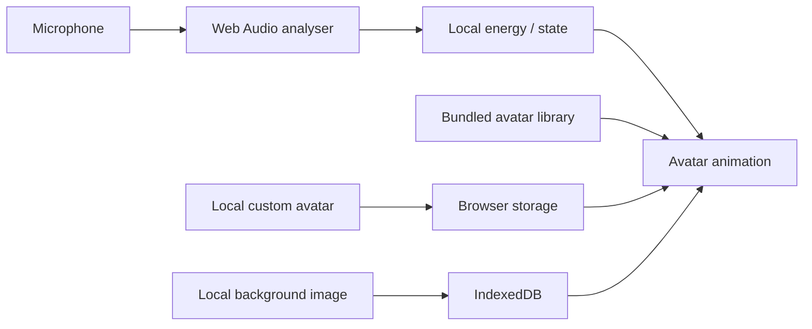
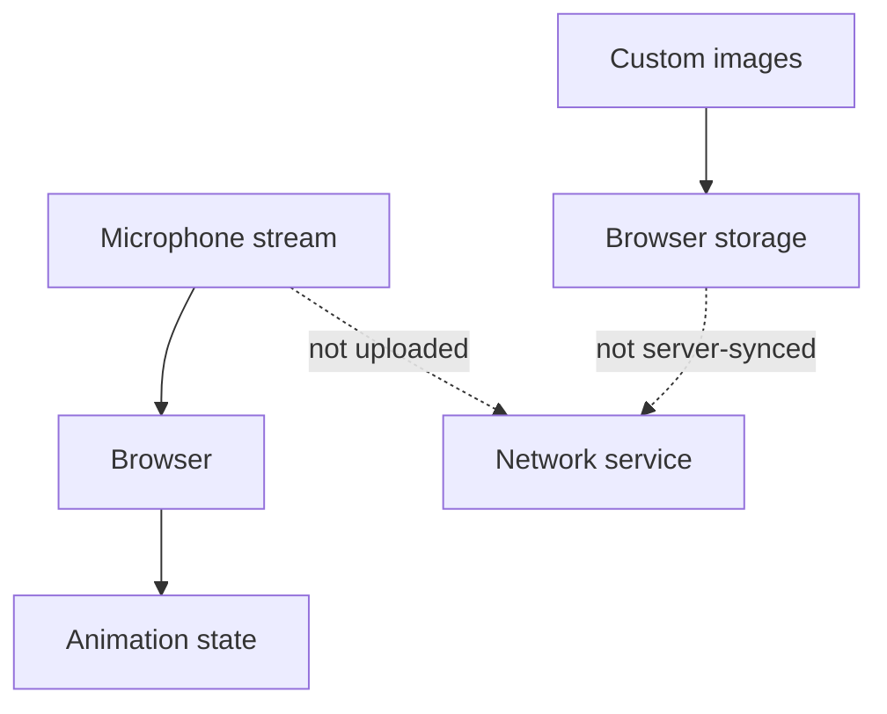

# Architecture

## Privacy boundary

## Publication boundary

GitHub Pages publishes tracked static assets. That makes image provenance/licensing part of the release surface even though microphone processing itself stays local.

See `DATA_PROVENANCE.md`.
